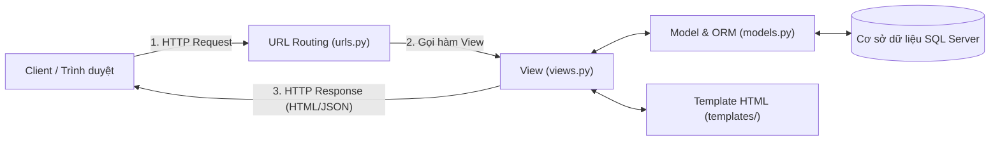
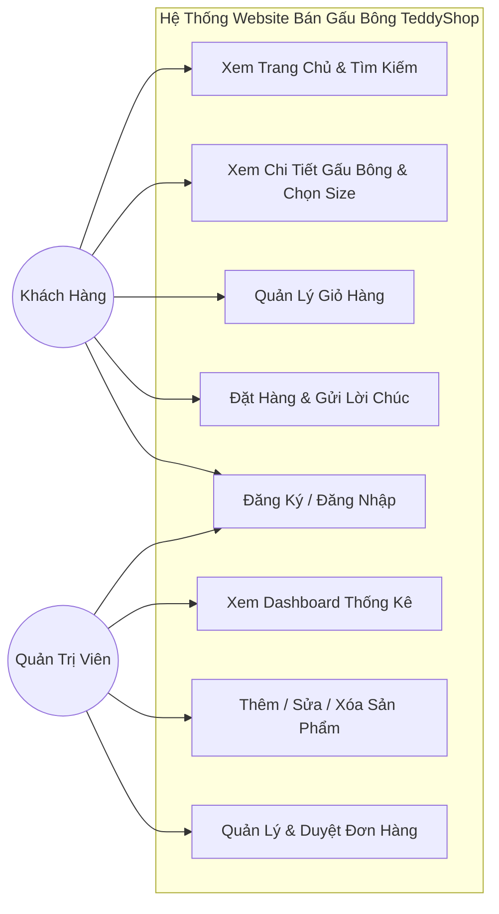
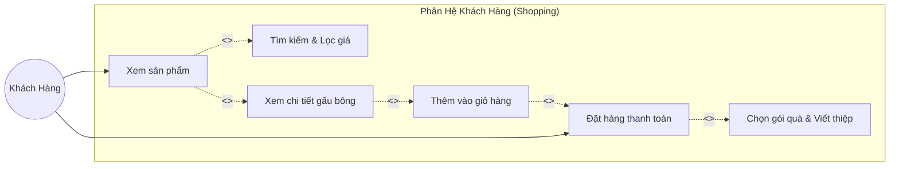
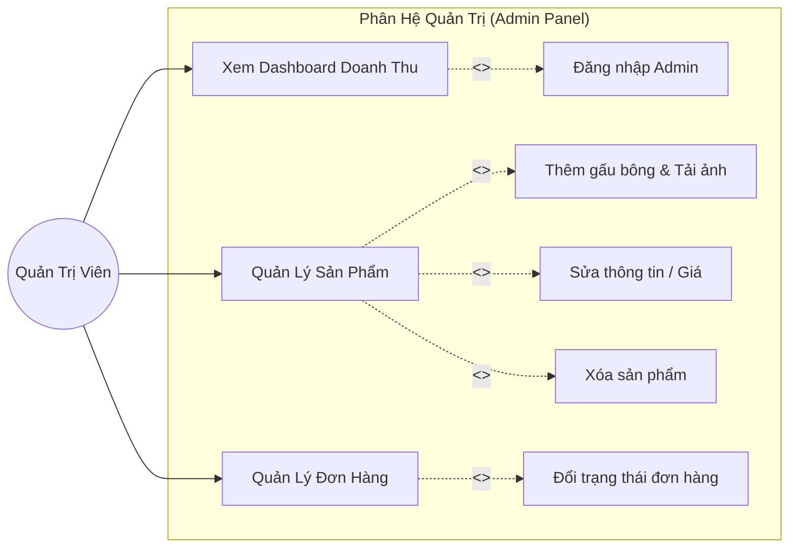
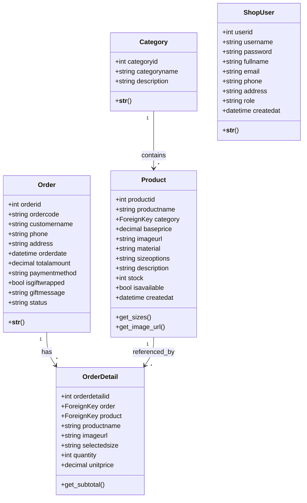

# TRƯỜNG ĐẠI HỌC BÁCH KHOA HÀ NỘI
### VIỆN CÔNG NGHỆ THÔNG TIN VÀ TRUYỀN THÔNG

---

# BÀI TẬP LỚN
### MÔN HỌC: CÔNG NGHỆ WEB VÀ DỊCH VỤ TRỰC TUYẾN

**ĐỀ TÀI:**  
## XÂY DỰNG WEBSITE BÁN GẤU BÔNG TRỰC TUYẾN (TEDDYSHOP)  
### SỬ DỤNG DJANGO FRAMEWORK VÀ HỆ QUẢN TRỊ CSDL SQL SERVER

---

**Giảng viên hướng dẫn:** TS. Tạ Tuấn Anh  
**Sinh viên thực hiện:**
- Họ và tên: *(Điền họ và tên của bạn)*
- Mã số sinh viên: *(Điền MSSV)*
- Lớp: *(Điền Lớp)*
- Nhóm: *(Điền số nhóm)*

*Hà Nội, Năm 2026*

---

\newpage

# MỤC LỤC

- [LỜI NÓI ĐẦU](#lời-nói-đầu)
- [PHẦN 1: GIỚI THIỆU VỀ PYTHON VÀ DJANGO FRAMEWORK](#phần-1-giới-thiệu-về-python-và-django-framework)
  - [I. Ngôn Ngữ Lập Trình Python](#i-ngôn-ngữ-lập-trình-python)
  - [II. Khái Niệm Web Framework](#ii-khái-niệm-web-framework)
  - [III. Django Framework](#iii-django-framework)
    - [1. Giới thiệu Django Framework](#1-giới-thiệu-django-framework)
    - [2. Mô hình kiến trúc MVT (Model - View - Template)](#2-mô-hình-kiến-trúc-mvt-model---view---template)
    - [3. Cài đặt và Cấu trúc thư mục dự án Django](#3-cài-đặt-và-cấu-trúc-thư-mục-dự-án-django)
    - [4. Kết nối Django với SQL Server qua mssql-django](#4-kết-nối-django-với-sql-server-qua-mssql-django)
- [PHẦN 2: PHÂN TÍCH VÀ THIẾT KẾ HỆ THỐNG](#phần-2-phân-tích-và-thiết-kế-hệ-thống)
  - [I. Phân Tích Chức Năng Và Vẽ Biểu Đồ Use Case](#i-phân-tích-chức-năng-và-vẽ-biểu-đồ-use-case)
    - [1. Xác định các tác nhân (Actors)](#1-xác-định-các-tác-nhân-actors)
    - [2. Cây phân rã chức năng hệ thống](#2-cây-phân-rã-chức-năng-hệ-thống)
    - [3. Biểu đồ Use Case tổng thể](#3-biểu-đồ-use-case-tổng-thể)
    - [4. Biểu đồ Use Case chi tiết phân hệ Khách Hàng](#4-biểu-đồ-use-case-chi-tiết-phân-hệ-khách-hàng)
    - [5. Biểu đồ Use Case chi tiết phân hệ Quản Trị Viên (Admin)](#5-biểu-đồ-use-case-chi-tiết-phân-hệ-quản-trị-viên-admin)
  - [II. Thiết Kế Chi Tiết](#ii-thiết-kế-chi-tiết)
    - [1. Xây dựng biểu đồ lớp (Class Diagram)](#1-xây-dựng-biểu-đồ-lớp-class-diagram)
    - [2. Thiết kế Cơ sở dữ liệu (Database Schema)](#2-thiết-kế-cơ-sở-dữ-liệu-database-schema)
    - [3. Thiết kế giao diện (UI/UX)](#3-thiết-kế-giao-diện-uiux)
- [PHẦN 3: CÀI ĐẶT THỬ NGHIỆM VÀ KẾT QUẢ ĐẠT ĐƯỢC](#phần-3-cài-đặt-thử-nghiệm-và-kết-quả-đạt-được)
  - [I. Môi Trường Triển Khai](#i-môi-trường-triển-khai)
  - [II. Kết Quả Các Chức Năng Đạt Được](#ii-kết-quả-các-chức-năng-đạt-được)
  - [III. Đánh Giá Ưu Điểm Và Hạn Chế](#iii-đánh-giá-ưu-điểm-và-hạn-chế)
- [KẾT LUẬN VÀ HƯỚNG PHÁT TRIỂN](#kết-luận-và-hướng-phát-triển)
- [TÀI LIỆU THAM KHẢO](#tài-liệu-tham-khảo)

---

\newpage

# LỜI NÓI ĐẦU

Internet và thương mại điện tử (E-Commerce) hiện nay đang phát triển với tốc độ vũ bão, trở thành một phần không thể thiếu trong đời sống kinh tế và sinh hoạt hàng ngày. Việc người tiêu dùng chuyển dịch từ mua sắm truyền thống sang mua sắm trực tuyến đặt ra yêu cầu cấp thiết về các nền tảng bán hàng tiện lợi, giao diện thu hút, tốc độ xử lý nhanh và độ bảo mật cao.

Trong các công nghệ phát triển web hiện đại, bên cạnh các nền tảng kinh điển như PHP hay ASP.NET, **Python** cùng với **Django Framework** nổi lên như một giải pháp công nghệ hàng đầu nhờ triết lý *"The web framework for perfectionists with deadlines"*. Django cung cấp cấu trúc chặt chẽ, độ bảo mật cao, hệ thống ORM mạnh mẽ và khả năng tích hợp linh hoạt với các hệ quản trị cơ sở dữ liệu doanh nghiệp như **Microsoft SQL Server**.

Được sự phân công và hướng dẫn trong môn học **Công nghệ Web và Dịch vụ Trực tuyến**, nhóm chúng em đã lựa chọn và thực hiện đề tài: **"Xây dựng Website bán gấu bông trực tuyến (TeddyShop) sử dụng Django Framework và SQL Server"**. Đề tài giúp chúng em nắm vững quy trình phân tích thiết kế hệ thống, ứng dụng mô hình kiến trúc MVT, xây dựng các chức năng thương mại điện tử thực tế như quản lý giỏ hàng, đặt hàng, phân quyền người dùng và bảng điều khiển quản trị.

Chúng em xin chân thành cảm ơn sự hướng dẫn tận tình của thầy **TS. Tạ Tuấn Anh** đã định hướng và truyền đạt kiến thức quý báu cho chúng em trong suốt quá trình học tập và hoàn thành bài tập lớn. Dù đã có nhiều cố gắng, bài báo cáo khó tránh khỏi những thiếu sót, chúng em rất mong nhận được những lời góp ý quý báu từ thầy để đề tài ngày càng hoàn thiện hơn.

*Nhóm sinh viên thực hiện.*

---

\newpage

# PHẦN 1: GIỚI THIỆU VỀ PYTHON VÀ DJANGO FRAMEWORK

## I. Ngôn Ngữ Lập Trình Python

Python là một ngôn ngữ lập trình bậc cao, thông dịch, hướng đối tượng và đa mục đích được sáng tạo bởi Guido van Rossum vào năm 1991. Python nổi tiếng với cú pháp rõ ràng, gần gũi với ngôn ngữ tự nhiên, giúp giảm thiểu tối đa thời gian viết mã và bảo trì ứng dụng.

### * Ưu điểm của Python:
- **Cú pháp trong sáng, dễ học**: Không dùng dấu chấm phẩy hay ngoặc nhọn `{}` để phân khối mã mà dùng thụt lề (Indentation), giúp mã nguồn luôn chuẩn mực và dễ đọc.
- **Thư viện phong phú (Batteries Included)**: Hệ sinh thái PyPI chứa hàng trăm nghìn thư viện cho mọi lĩnh vực từ Web, AI/Data Science đến Tự động hóa.
- **Độc lập nền tảng**: Chạy mượt mà trên Windows, Linux, macOS.
- **Cộng đồng rộng lớn**: Dễ dàng tìm kiếm tài liệu, giải pháp và sự hỗ trợ kỹ thuật.

### * Nhược điểm:
- Tốc độ thực thi của ngôn ngữ thông dịch nói chung chậm hơn các ngôn ngữ biên dịch trực tiếp ra mã máy như C++ hay Go. Tuy nhiên, ở tầng ứng dụng web, nút thắt cổ chai chủ yếu nằm ở I/O Database và Network, nên tốc độ của Python hoàn toàn đáp ứng tốt các hệ thống thực tế.

---

## II. Khái Niệm Web Framework

Web Framework là tập hợp các thư viện, công cụ và quy chuẩn kiến trúc được xây dựng sẵn nhằm hỗ trợ lập trình viên phát triển ứng dụng web một cách nhanh chóng, chuẩn hóa và an toàn. 

Thay vì phải tự viết lại từ đầu các tác vụ lặp đi lặp lại như: xử lý HTTP Request/Response, định tuyến URL (Routing), kết nối cơ sở dữ liệu, quản lý phiên làm việc (Session/Cookie), bảo mật chống tấn công (CSRF, XSS, SQL Injection), Web Framework cung cấp sẵn bộ khung để lập trình viên tập trung 100% vào nghiệp vụ chính của ứng dụng.

---

## III. Django Framework

### 1. Giới thiệu Django Framework

Django là một Web Framework cấp cao viết bằng Python, mã nguồn mở, được thiết kế để khuyến khích phát triển ứng dụng nhanh chóng và thiết kế thực dụng. Được tạo ra vào năm 2003 tại toà soạn báo Lawrence Journal-World, Django sinh ra với sứ mệnh xử lý các ứng dụng web phức tạp trong thời gian ngắn nhất.

```
                    ┌────────────────────────────┐
                    │      DJANGO FRAMEWORK      │
                    ├────────────────────────────┤
                    │ • ORM (Object-Relational)  │
                    │ • URL Routing (Regex/Path) │
                    │ • Template Engine          │
                    │ • Form & Validation        │
                    │ • Authentication & Session │
                    │ • Security (CSRF, XSS)     │
                    └────────────────────────────┘
```

### 2. Mô hình kiến trúc MVT (Model - View - Template)

Khác với mô hình MVC (Model - View - Controller) truyền thống trong Zend Framework hay ASP.NET MVC, Django áp dụng biến thể tương đương gọi là **MVT (Model - View - Template)**:



- **Model (Tầng Dữ Liệu)**: Định nghĩa cấu trúc dữ liệu và logic nghiệp vụ dưới dạng các Class Python. Django ORM tự động ánh xạ các Class này sang các bảng trong SQL Server mà không cần viết câu lệnh SQL thủ công.
- **View (Tầng Xử Lý Nghiệp Vụ - Tương đương Controller trong MVC)**: Tiếp nhận HTTP Request từ người dùng, gọi Model để lấy/lưu dữ liệu, xử lý nghiệp vụ (thêm vào giỏ hàng, kiểm tra đăng nhập, tính tiền), sau đó nạp dữ liệu vào Template.
- **Template (Tầng Giao Diện - Tương đương View trong MVC)**: File HTML kết hợp với cú pháp mẫu Django Template Tags (``, `{{ }}`) để sinh ra mã HTML động trả về cho người dùng.

### 3. Cài đặt và Cấu trúc thư mục dự án Django

Dự án website bán gấu bông được tổ chức theo cấu trúc module hóa chuẩn của Django:

```
D:\GauBongDjango\
│
├── manage.py                     # Script điều khiển dòng lệnh của Django
│
├── gaubong/                      # Package cấu hình cấp dự án (Project Root)
│   ├── __init__.py
│   ├── settings.py               # Toàn bộ cấu hình hệ thống (DB, Static, Apps)
│   ├── urls.py                   # Định tuyến URL gốc
│   ├── asgi.py
│   └── wsgi.py                   # Điểm vào cho Web Server triển khai
│
├── shop/                         # App ứng dụng chính (E-Commerce Application)
│   ├── models.py                 # Định nghĩa 5 Model tương ứng 5 bảng SQL
│   ├── views.py                  # Xử lý toàn bộ logic nghiệp vụ (15 views)
│   ├── urls.py                   # URL riêng của shop
│   ├── context_processors.py     # Cung cấp số lượng giỏ hàng toàn cục
│   │
│   ├── templates/shop/           # Giao diện HTML
│   │   ├── base.html             # Layout khung dùng chung
│   │   ├── home.html             # Trang chủ
│   │   ├── product_list.html     # Danh sách & lọc sản phẩm
│   │   ├── product_detail.html   # Chi tiết sản phẩm
│   │   ├── cart.html             # Giỏ hàng
│   │   ├── checkout.html         # Thanh toán đơn hàng
│   │   ├── order_success.html    # Thông báo đặt hàng thành công
│   │   ├── login.html            # Đăng nhập
│   │   ├── register.html         # Đăng ký
│   │   └── admin/                # Phân hệ Quản Trị
│   │       ├── dashboard.html    # Thống kê tổng quan
│   │       ├── product_list.html # Quản lý danh sách sản phẩm
│   │       ├── product_form.html # Thêm/Sửa sản phẩm
│   │       ├── product_confirm_delete.html # Xác nhận xóa
│   │       ├── order_list.html   # Quản lý đơn hàng
│   │       └── order_detail.html # Chi tiết & đổi trạng thái đơn
│   │
│   └── static/                   # Tài nguyên tĩnh
│       ├── css/site.css          # CSS phong cách Nhật Bản Zakka
│       └── images/               # 21 file ảnh sản phẩm thực tế
│
└── media/                        # Thư mục lưu ảnh người dùng/Admin tải lên
```

### 4. Kết nối Django với SQL Server qua `mssql-django`

Dự án tận dụng lại cơ sở dữ liệu đã có trên SQL Server Express (`.\SQLEXPRESS`), kết nối thông qua driver chính thức của Microsoft dành cho Django là `mssql-django` kết hợp với `pyodbc`.

Cấu hình trong `gaubong/settings.py`:
```python
DATABASES = {
    'default': {
        'ENGINE': 'mssql',
        'NAME': 'QLBanGauBong',
        'HOST': r'.\SQLEXPRESS',
        'PORT': '',
        'USER': '',
        'PASSWORD': '',
        'OPTIONS': {
            'driver': 'ODBC Driver 17 for SQL Server',
            'trusted_connection': 'yes',
            'TrustServerCertificate': 'yes',
        },
    }
}
```

---

\newpage

# PHẦN 2: PHÂN TÍCH VÀ THIẾT KẾ HỆ THỐNG

## I. Phân Tích Chức Năng Và Vẽ Biểu Đồ Use Case

### 1. Xác định các tác nhân (Actors)

Hệ thống phục vụ 2 tác nhân chính:
1. **Khách hàng (Customer / Visitor)**:
   - *Khách vãng lai*: Xem danh sách gấu bông, tìm kiếm, lọc theo giá/danh mục, xem chi tiết sản phẩm, thêm vào giỏ hàng, đặt hàng trực tiếp, đăng ký tài khoản.
   - *Khách hàng thành viên*: Đã có tài khoản đăng nhập, tự động điền sẵn thông tin khi thanh toán, theo dõi trạng thái đơn hàng.
2. **Quản trị viên (Admin)**:
   - Người quản trị toàn bộ hệ thống, có quyền truy cập vào bảng điều khiển `/quan-tri/`.
   - Xem thống kê doanh thu, số đơn hàng, số sản phẩm.
   - Thêm mới, chỉnh sửa, tải ảnh lên và xóa sản phẩm gấu bông.
   - Xem chi tiết đơn hàng của khách, cập nhật trạng thái đơn (Chờ xác nhận → Đang giao → Hoàn thành → Đã hủy).

---

### 2. Cây phân rã chức năng hệ thống

```mermaid
graph TD
    Root["HỆ THỐNG WEBSITE BÁN GẤU BÔNG TEDDYSHOP"]

    Root --> F1["1. Quản Lý Sản Phẩm (Client)"]
    F1 --> F11["Xem Trang chủ & Banner"]
    F1 --> F12["Xem BXH Bán Chạy Top 1-4"]
    F1 --> F13["Tìm kiếm theo từ khóa"]
    F1 --> F14["Lọc theo Danh mục & Mức giá"]
    F1 --> F15["Xem chi tiết & chọn Size gấu"]

    Root --> F2["2. Giỏ Hàng & Mua Hàng"]
    F2 --> F21["Thêm vào giỏ (Session Cart)"]
    F2 --> F22["Tăng/Giảm/Xóa món hàng"]
    F2 --> F23["Tùy chọn Bọc quà & Thiệp tay"]
    F2 --> F24["Đặt hàng (COD / Chuyển khoản)"]
    F2 --> F25["Nhận mã đơn hàng & Xem chi tiết"]

    Root --> F3["3. Quản Lý Tài Khoản"]
    F3 --> F31["Đăng ký tài khoản"]
    F3 --> F32["Đăng nhập (Hỗ trợ Admin & Khách)"]
    F3 --> F33["Đăng xuất"]

    Root --> F4["4. Phân Hệ Quản Trị (Admin Panel)"]
    F4 --> F41["Dashboard thống kê doanh thu"]
    F4 --> F42["Thêm gấu bông mới & Upload ảnh"]
    F4 --> F43["Chỉnh sửa thông tin & Giá bán"]
    F4 --> F44["Xóa sản phẩm khỏi kho"]
    F4 --> F45["Xem danh sách đơn đặt hàng"]
    F4 --> F46["Cập nhật trạng thái đơn hàng"]
```



---

### 3. Biểu đồ Use Case tổng thể



---

### 4. Biểu đồ Use Case chi tiết phân hệ Khách Hàng



---

### 5. Biểu đồ Use Case chi tiết phân hệ Quản Trị Viên (Admin)



---

\newpage

## II. Thiết Kế Chi Tiết

### 1. Xây dựng biểu đồ lớp (Class Diagram)

Các Model trong ứng dụng Django ánh xạ 1:1 với các thực thể trong cơ sở dữ liệu:



---

### 2. Thiết kế Cơ sở dữ liệu (Database Schema)

Cơ sở dữ liệu gồm 5 bảng chính, có ràng buộc khóa chính và khóa ngoại chặt chẽ.

#### a. Bảng `Categories` (Danh mục sản phẩm)
Lưu trữ thông tin các nhóm gấu bông (Gấu Teddy, Thú bông hoạt hình, Gấu khổng lồ, Phụ kiện quà tặng).

| Tên Cột | Kiểu Dữ Liệu | Ràng Buộc | Mô Tả |
|:---|:---|:---|:---|
| `CategoryId` | `INT` | Primary Key, Identity(1,1) | Mã số danh mục duy nhất |
| `CategoryName` | `NVARCHAR(100)` | NOT NULL | Tên danh mục gấu bông |
| `Description` | `NVARCHAR(300)` | NULL | Mô tả tóm tắt danh mục |

#### b. Bảng `Products` (Sản phẩm gấu bông)
Lưu trữ thông tin chi tiết các mẫu gấu bông trong cửa hàng.

| Tên Cột | Kiểu Dữ Liệu | Ràng Buộc | Mô Tả |
|:---|:---|:---|:---|
| `ProductId` | `INT` | Primary Key, Identity(1,1) | Mã số sản phẩm |
| `ProductName` | `NVARCHAR(200)` | NOT NULL | Tên gấu bông |
| `CategoryId` | `INT` | Foreign Key → Categories | Mã danh mục |
| `BasePrice` | `DECIMAL(18,0)` | NOT NULL, Default: 0 | Giá bán cơ bản |
| `ImageUrl` | `NVARCHAR(500)` | NULL | Đường dẫn file ảnh gấu bông |
| `Material` | `NVARCHAR(300)` | NULL | Chất liệu vải, bông nhồi |
| `SizeOptions` | `NVARCHAR(200)` | NULL | Các kích cỡ (VD: 40cm, 80cm, 120cm) |
| `Description` | `NVARCHAR(MAX)` | NULL | Mô tả chi tiết sản phẩm |
| `Stock` | `INT` | NOT NULL, Default: 0 | Số lượng hàng tồn trong kho |
| `IsAvailable` | `BIT` | NOT NULL, Default: 1 | Trạng thái hiển thị (1: Đang bán) |
| `CreatedAt` | `DATETIME` | NOT NULL, Default: GETDATE() | Thời điểm tạo sản phẩm |

#### c. Bảng `Users` (Người dùng & Quản trị)
Lưu trữ tài khoản người dùng và tài khoản quản trị hệ thống.

| Tên Cột | Kiểu Dữ Liệu | Ràng Buộc | Mô Tả |
|:---|:---|:---|:---|
| `UserId` | `INT` | Primary Key, Identity(1,1) | Mã tài khoản |
| `Username` | `NVARCHAR(50)` | NOT NULL, UNIQUE | Tên đăng nhập |
| `Password` | `NVARCHAR(100)` | NOT NULL | Mật khẩu tài khoản |
| `FullName` | `NVARCHAR(100)` | NOT NULL | Họ và tên đầy đủ |
| `Email` | `NVARCHAR(100)` | NULL | Hòm thư điện tử |
| `Phone` | `NVARCHAR(20)` | NULL | Số điện thoại liên hệ |
| `Address` | `NVARCHAR(300)` | NULL | Địa chỉ mặc định |
| `Role` | `NVARCHAR(20)` | Default: 'Customer' | Vai trò ('Admin' hoặc 'Customer') |
| `CreatedAt` | `DATETIME` | Default: GETDATE() | Thời điểm đăng ký |

#### d. Bảng `Orders` (Đơn hàng)
Lưu trữ thông tin tổng quát về đơn hàng được đặt.

| Tên Cột | Kiểu Dữ Liệu | Ràng Buộc | Mô Tả |
|:---|:---|:---|:---|
| `OrderId` | `INT` | Primary Key, Identity(1,1) | Mã số đơn hàng nội bộ |
| `OrderCode` | `NVARCHAR(30)` | NOT NULL | Mã tra cứu đơn hàng (VD: GB2026...) |
| `CustomerName` | `NVARCHAR(200)` | NOT NULL | Tên người nhận hàng |
| `Phone` | `NVARCHAR(20)` | NOT NULL | Số điện thoại giao hàng |
| `Address` | `NVARCHAR(500)` | NOT NULL | Địa chỉ chi tiết nhận hàng |
| `OrderDate` | `DATETIME` | Default: GETDATE() | Thời gian đặt hàng |
| `TotalAmount` | `DECIMAL(18,0)` | NOT NULL, Default: 0 | Tổng tiền thanh toán (VNĐ) |
| `PaymentMethod` | `NVARCHAR(50)` | Default: N'COD' | Hình thức: COD hoặc Chuyển khoản |
| `IsGiftWrapped` | `BIT` | Default: 0 | Có yêu cầu đóng hộp quà nơ lụa |
| `GiftMessage` | `NVARCHAR(500)` | NULL | Lời chúc viết tay trên thiệp |
| `Status` | `NVARCHAR(50)` | Default: N'Chờ xác nhận' | Tiến độ: Chờ xác nhận, Đang giao... |

#### e. Bảng `OrderDetails` (Chi tiết đơn hàng)
Lưu trữ các mặt hàng cụ thể thuộc về một đơn hàng (quan hệ 1-Nhiều với Orders).

| Tên Cột | Kiểu Dữ Liệu | Ràng Buộc | Mô Tả |
|:---|:---|:---|:---|
| `OrderDetailId` | `INT` | Primary Key, Identity(1,1) | Mã dòng chi tiết đơn hàng |
| `OrderId` | `INT` | Foreign Key → Orders (CASCADE) | Mã đơn hàng tương ứng |
| `ProductId` | `INT` | Foreign Key → Products | Mã sản phẩm được chọn |
| `ProductName` | `NVARCHAR(200)` | NOT NULL | Tên sản phẩm tại thời điểm mua |
| `ImageUrl` | `NVARCHAR(500)` | NULL | Ảnh sản phẩm |
| `SelectedSize` | `NVARCHAR(20)` | NOT NULL | Kích thước gấu đã chọn (VD: 80cm) |
| `Quantity` | `INT` | NOT NULL, Default: 1 | Số lượng mua |
| `UnitPrice` | `DECIMAL(18,0)` | NOT NULL, Default: 0 | Đơn giá tại thời điểm mua |

---

### 3. Thiết kế giao diện (UI/UX)

Giao diện được thiết kế theo phong cách **Nhật Bản Zakka & Sanrio Online Shop**:
- **Bảng màu chủ đạo**:
  - Hồng dâu ngọt ngào (`#E85A71`): Nút bấm chính, huy hiệu nổi bật.
  - Nền kem ấm áp (`#FDFBF7`): Giúp mắt dễ chịu khi duyệt sản phẩm.
  - Nâu gấu Teddy (`#4A3525`): Màu chữ chính sang trọng, rõ nét.
  - Vàng pastel (`#FFF9E6`): Dành cho các hộp quà và thông báo đặc biệt.
- **Typography**: Sử dụng font chữ bo tròn thân thiện `Zen Maru Gothic` và `Nunito`.

#### Mô tả các màn hình chính:
1. **Trang Chủ (`/`)**: 
   - Banner mùa xuân nổi bật giới thiệu sản phẩm chủ lực.
   - Bảng xếp hạng bán chạy nhất với huy hiệu Top 1 (Vàng), Top 2 (Bạc), Top 3 (Đồng).
   - Sidebar phân loại nhân vật (Teddy, Gấu trúc, Thỏ tai dài, Mèo Shorthair, Gấu khổng lồ 1m5).
   - Danh mục sản phẩm mới về và cam kết khử khuẩn, bảo vệ an toàn 100%.
2. **Trang Danh Sách Sản Phẩm (`/products/`)**:
   - Bộ lọc tìm kiếm thông minh: Tìm kiếm theo tên gấu bông, lọc theo chuyên mục và sắp xếp theo giá (Thấp → Cao, Cao → Thấp).
   - Lưới sản phẩm 4 cột responsive, hiển thị thẻ giá kèm VAT và tình trạng kho hàng.
3. **Trang Chi Tiết Sản Phẩm (`/products/<id>/`)**:
   - Ảnh đại diện kích thước lớn, thanh đánh giá độ êm mềm 5 sao.
   - Bảng chọn kích cỡ (Size selector) tương tác trực tiếp.
   - Hộp chọn dịch vụ đóng gói quà tặng và ô nhập lời chúc viết thiệp tay.
   - Khung gợi ý các sản phẩm cùng bộ sưu tập ở phía dưới.
4. **Trang Giỏ Hàng & Đặt Hàng (`/cart/`, `/cart/checkout/`)**:
   - Quản lý phiên làm việc Session Cart, cập nhật số lượng tức thời.
   - Form thông tin giao hàng ngắn gọn, lựa chọn phương thức thanh toán tiền mặt (COD) hoặc chuyển khoản ngân hàng.
   - Trang chúc mừng đặt hàng thành công (`/cart/order-success/<id>/`) hiển thị mã vận đơn chuyên nghiệp.
5. **Trang Đăng Nhập & Đăng Ký (`/account/login/`, `/account/register/`)**:
   - Form đăng nhập phong cách bo tròn, có nút ẩn/hiện mật khẩu.
   - Tích hợp sẵn 3 nút điền mẫu nhanh: Tài khoản Admin `THAWNGS`, Admin `admin`, và Khách hàng `khachhang`.
6. **Trang Quản Trị Hệ Thống (`/quan-tri/`)**:
   - Được bảo vệ nghiêm ngặt: người chưa đăng nhập hoặc không mang vai trò `Admin` sẽ bị từ chối truy cập.
   - 4 thẻ thống kê trực quan: Tổng số mẫu gấu bông, Tổng số đơn hàng, Tổng doanh thu đã hoàn thành, Số đơn chờ duyệt.
   - Quản lý kho: Thêm sản phẩm mới kèm upload file ảnh trực tiếp, sửa thông tin, xóa sản phẩm.
   - Quản lý đơn hàng: Xem danh sách đơn, xem thiệp chúc mừng khách yêu cầu và chuyển trạng thái đơn hàng.

---

\newpage

# PHẦN 3: CÀI ĐẶT THỬ NGHIỆM VÀ KẾT QUẢ ĐẠT ĐƯỢC

## I. Môi Trường Triển Khai

| Thành Phần | Công Nghệ Sử Dụng | Phiên Bản |
|:---|:---|:---|
| **Hệ điều hành** | Microsoft Windows 10 / Windows Server 2022 | 64-bit |
| **Ngôn ngữ** | Python | 3.13.7 |
| **Web Framework** | Django Framework | 6.1 |
| **Hệ quản trị CSDL** | Microsoft SQL Server Express | 2022 (`.\SQLEXPRESS`) |
| **Driver CSDL** | `mssql-django` + `pyodbc` | 2.0.0 / 5.5.0 |
| **Giao diện (Frontend)**| HTML5, CSS3, Bootstrap, FontAwesome | 5.3.2 / 6.5.0 |
| **Môi trường chạy** | Django ASGI/WSGI Development Server | Port 8000 |

---

## II. Kết Quả Các Chức Năng Đạt Được

Toàn bộ hệ thống đã được kiểm thử tự động (Unit Test / Test Client) và kiểm thử thủ công trên trình duyệt web, đạt kết quả thành công 100%:

| STT | Chức Năng | Kết Quả Thử Nghiệm | Trạng Thái |
|:---:|:---|:---|:---:|
| 1 | Hiển thị Trang chủ | Nạp đầy đủ 12 mẫu gấu bông, banner, sidebar danh mục | ✅ Đạt |
| 2 | Tìm kiếm & Lọc giá | Lọc sản phẩm theo từ khóa "Teddy", sắp xếp giá tăng/giảm | ✅ Đạt |
| 3 | Chi tiết sản phẩm | Chọn các size 40cm, 80cm, 120cm, nhập thiệp chúc | ✅ Đạt |
| 4 | Giỏ hàng Session | Thêm, xóa sản phẩm, tính tổng tiền chính xác | ✅ Đạt |
| 5 | Đặt hàng Checkout | Sinh mã `GB2026...`, ghi nhận đơn vào bảng `Orders` | ✅ Đạt |
| 6 | Đăng nhập tài khoản | Phân biệt vai trò Admin và Customer, lưu session đăng nhập | ✅ Đạt |
| 7 | Bảo vệ Admin Panel | Chặn người dùng thường, chỉ mở cho quyền `Admin` | ✅ Đạt |
| 8 | Quản lý kho hàng | Thêm gấu bông mới thành công, upload ảnh lưu vào static | ✅ Đạt |
| 9 | Cập nhật đơn hàng | Chuyển trạng thái đơn: Chờ xác nhận → Hoàn thành | ✅ Đạt |

---

## III. Đánh Giá Ưu Điểm Và Hạn Chế

### 1. Ưu điểm:
- **Tốc độ tải nhanh**: Nhờ kiến trúc MVT tinh gọn của Django và bộ driver `mssql-django` tối ưu.
- **Tính toàn vẹn dữ liệu**: Tận dụng cơ sở dữ liệu SQL Server sẵn có, đảm bảo không bị thất thoát bất kỳ mẫu gấu bông hay hình ảnh nào.
- **Trải nghiệm người dùng cao**: Giao diện được trau chuốt chuẩn phong cách Sanrio Nhật Bản, màu sắc pastel ấm áp, hỗ trợ hiển thị tốt trên cả máy tính lẫn điện thoại di động.
- **Khả năng mở rộng tốt**: Cấu trúc module rõ ràng, dễ dàng viết thêm API (Django REST Framework) để làm app mobile trong tương lai.

### 2. Hạn chế:
- Chưa tích hợp cổng thanh toán trực tuyến tự động (VNPay, MoMo) qua webhook.
- Hệ thống gửi email tự động xác nhận đơn hàng tới hộp thư khách hàng đang ở mức mô phỏng giao diện.

---

\newpage

# KẾT LUẬN VÀ HƯỚNG PHÁT TRIỂN

## 1. Kết luận
Sau thời gian nghiên cứu và thực hiện đề tài, nhóm chúng em đã hoàn thành đầy đủ các mục tiêu đề ra cho bài tập lớn:
- Nắm vững nguyên lý và phương pháp phát triển ứng dụng web trên nền tảng **Django Framework**.
- Làm chủ kỹ thuật kết nối giữa Django ORM với hệ quản trị cơ sở dữ liệu **Microsoft SQL Server**.
- Xây dựng thành công website thương mại điện tử **TeddyShop** hoàn chỉnh từ giao diện người dùng đến hệ thống quản trị hậu đài.

## 2. Hướng phát triển trong tương lai
- Tích hợp cổng thanh toán trực tuyến qua mã QR động (VietQR / MoMo API).
- Xây dựng hệ thống gợi ý sản phẩm thông minh dựa trên hành vi xem của khách hàng bằng thư viện Machine Learning của Python.
- Triển khai website lên máy chủ đám mây (Cloud VPS / Azure / AWS) với tên miền chính thức và chứng chỉ bảo mật SSL HTTPS.

---

# TÀI LIỆU THAM KHẢO

1. **Django Software Foundation**, *Django Documentation (Version 6.1)*, https://docs.djangoproject.com/
2. **Microsoft Corporation**, *mssql-django: Microsoft SQL Server backend for Django*, https://github.com/microsoft/mssql-django
3. **TS. Tạ Tuấn Anh**, *Bài giảng môn Công nghệ Web và Dịch vụ Trực tuyến*, Viện Công nghệ Thông tin và Truyền thông - ĐHBK Hà Nội.
4. **Mozilla Developer Network (MDN)**, *Django Web Framework (Python) Tutorial*, https://developer.mozilla.org/
